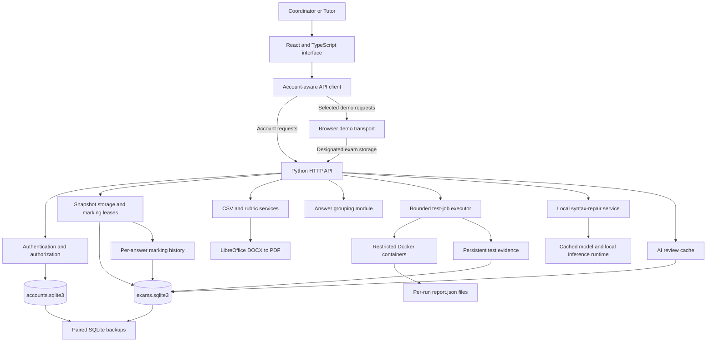
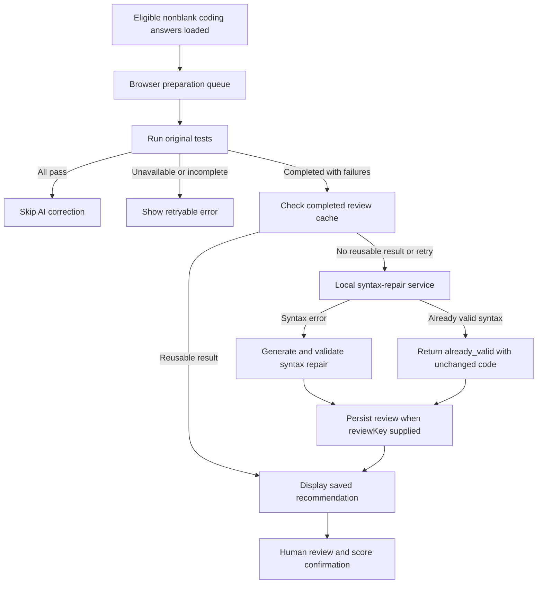

# AutoMarktic — Architecture

## Source and version control

Prepared 9 November 2026. Implementation baseline: local `IT-Project-API`, branch `fixing`, commit `cc5cb46`. The account database has local runtime changes and is not part of this documentation baseline. This document is a reviewable consolidation, not evidence that all requirements have passed acceptance testing.

- [Requirements Document](https://jessiejosephjeyasingh.atlassian.net/wiki/spaces/CJM1P/pages/2261177/Requirements+Document), page displayed “Edited Oct 24”.
- [User Stories](https://jessiejosephjeyasingh.atlassian.net/wiki/spaces/CJM1P/pages/3407984/User+Stories), Epics 1–9.
- [Architecture Goals and Constraints](https://jessiejosephjeyasingh.atlassian.net/wiki/spaces/CJM1P/pages/7143558/Architecture+Goals+and+Constraints), AG1–AG8 and AC1–AC13.
- [System Architecture Design Model](https://jessiejosephjeyasingh.atlassian.net/wiki/spaces/CJM1P/pages/3965008/System+Architecture+Design+Model), Version 1 PDF, 5 September 2026; attachment preview inspected.
- [System Diagram](https://jessiejosephjeyasingh.atlassian.net/wiki/spaces/CJM1P/pages/7209370/System+Diagram), Version 2 PDF, 3 September 2026; attachment preview inspected.

The Confluence pages were read, not intentionally edited. Local source extracts and diagram screenshots are retained in `sources/`. Requirements express intended behaviour; implementation notes describe the inspected code. Proposed changes require team/client agreement and do not silently replace the source baseline.

## Evolution from the Confluence architecture

The original diagrams separate presentation, application, execution, model and database layers. That logical separation remains useful, but the technologies in those diagrams are an earlier design, not the deployed stack.

| Concern | Confluence diagram | Current implementation |
| --- | --- | --- |
| Browser UI | React, JavaScript, Vite | React 19, TypeScript, Vite; hash-based navigation |
| API | FastAPI / Python 3.12 | Python `ThreadingHTTPServer` and `BaseHTTPRequestHandler` |
| Validation / persistence | Pydantic, SQLAlchemy | Explicit Python validation and `sqlite3`; frontend domain validation |
| Database | PostgreSQL, Alembic | Two SQLite files; nested exam registries as JSON; lazy table creation |
| Code execution | Docker SDK and pytest | Docker command-line execution with project-specific Python runner and configured cases |
| Model | Ollama and LoRA adapter | Transformers/PyTorch loading the pinned syntax-repair checkpoint directly |
| Authentication | Undecided / possible SSO | Local accounts, invitations, sessions and recovery codes; no SSO integration |
| Deployment | Coordinator host, tutor browsers | Local host implementation; shared remote access requires explicit hosting/proxy configuration |

Do not infer implemented FastAPI, PostgreSQL, Alembic, Ollama or SSO services from the old diagrams. The independent `database/` PostgreSQL tooling is not the active web application's storage. The original reference GPU (RX 7900 XTX, 24 GB VRAM, 64 GB RAM) is a design target, not a device validated in this documentation task.

## 1. Purpose and system boundary

AutoMarktic supports coordinators preparing programming exams and tutors reviewing student responses. Its main activities are Canvas CSV import, rubric preparation, question classification, answer grouping, isolated answer tests, local AI syntax-repair suggestions and human-confirmed marking.

The main application runs on a local host. A React browser interface communicates with a Python HTTP API. SQLite stores accounts and exam snapshots; Docker executes submitted Python in restricted containers; a local model provides syntax-repair suggestions. Human confirmation remains separate from source CSV scores, test results and model recommendations.

Three execution modes must be distinguished:

| Mode | API and computation | Storage |
| --- | --- | --- |
| Signed-in account workspace | Real Python API, role checks, Docker tests and local AI when configured | Backend SQLite exam registry and AI review cache; auxiliary UI/profile state remains browser-side |
| Local demonstration in the main checkout | Mixed transport: simulated uploads/grouping and selected real backend requests | Most demonstration changes are page-local; the designated Final 2026 exam uses SQLite |
| Separately published client demo | Separate frontend project under `IT Project/sites/automarktic-client-demo`; intended for simulated presentation | Browser-only demonstration state; not proof of production persistence or multiuser operation |

The published demo's current deployment was not reverified for this document. Its deployment/source release must be tracked independently of the main application.

## 2. Component overview

The backend uses `http.server.ThreadingHTTPServer` and `BaseHTTPRequestHandler`; it is not a FastAPI or Node.js application. Node.js runs frontend tooling and the development launcher. Vite serves the frontend during development and proxies `/api` requests to Python. Production-build serving requires an explicit hosting/proxy arrangement.

## 3. Module responsibilities

Paths below are relative to the `IT-Project-API` repository root.

| Module | Responsibility |
| --- | --- |
| `frontend/src/main.tsx` | Hash-route selection and page composition |
| `frontend/src/state.tsx` | Workspace UI state, registry loading/saving, revision tracking and AI queue integration |
| `frontend/src/auth/` | Verified account session lifecycle |
| `frontend/src/api/` | HTTP contracts, account/demo routing, error handling, test polling and lock credentials |
| `frontend/src/pages/` | Authentication, workspace, exam, import and marking screens |
| `frontend/src/components/rubric/` | Document selection, rubric editing and display |
| `frontend/src/components/marking/` | Grouping, tests, AI recommendations and marking information |
| `frontend/src/models/`, `frontend/src/utils/` | Data shapes, question types, grouping/score validation and rubric-change calculations |
| `frontend/src/services/aiReviewQueue.ts` | Browser-driven, serial preparation of eligible AI reviews |
| `frontend/src/demo/` | Presentation fixtures, simulated transport and mixed demo persistence |
| `backend/api/server.py`, `handler.py` | HTTP server lifecycle and route dispatch |
| `backend/api/auth.py`, `backend/security/accounts.py` | Request authorization, account/session storage, invitations and recovery |
| `backend/api/exams.py`, `marking_locks.py` | Exam snapshots, revision checks, answer leases and conflicting-save checks |
| `backend/services/` | Canvas parsing, rubric extraction and DOCX conversion |
| `auto_marking/answer_grouping/` | Answer grouping implementation |
| `auto_marking/jobs.py`, `test_runner/` | Test scheduling, suite selection, Docker execution and report interpretation |
| `ai_tools/code_repair/`, `ai_recommendation.py`, `model_download.py` | Syntax repair, inference coordination and explicit model setup |
| `backend/api/ai_cache.py` | Persist and reuse completed AI review responses |
| `database/` | Independent PostgreSQL design and management tools; not the active web API storage |
| `setup/`, `frontend/scripts/dev.mjs` | Installation and local process orchestration |

## 4. Authentication and authorization

The first registered account is a coordinator. Subsequent registrations use email-bound invitation codes issued by a coordinator. Password recovery uses coordinator-issued, single-use codes; the app does not send email. Passwords are salted and hashed with PBKDF2-HMAC-SHA256. Sessions are stored using token hashes rather than raw session tokens.

Sessions have an eight-hour maximum lifetime and a 30-minute idle timeout. Account cookies are HttpOnly and SameSite=Strict. The server checks Host/Origin and application request headers; signed-in mutations require a session-bound CSRF token. An explicitly configured HTTPS public origin supports the documented temporary sharing workflow.

CSV/rubric imports, account listing, invitations, reset-code issuance and model-download mutations have coordinator restrictions. Tutors may mark, group answers and request tests/AI. For registry updates, the backend prevents Tutors from changing exam setup by comparing fields other than `marks`, `groupMarkHistory` and `answerGrouping`.

The local demo API is enabled by default and uses explicit demo headers. It cannot administer real accounts. Set `ALLOW_DEMO_API=0` when backend access must require real accounts. This configuration boundary is part of deployment, not a substitute for authorization.

**Access-model limitation:** `AccountStore` supplies one installation-level `workspaceId` to all accounts in that store. Browser workspace records are not a backend team-membership/assignment ACL. Invitations do not implement per-team or per-exam access restrictions. Fine-grained account removal, role changes and assigned-exam visibility must not be inferred from the demonstration UI.

## 5. Data architecture

### 5.1 Account storage

Default file: `backend/data/private/accounts.sqlite3` (configurable through `AUTH_DB_PATH`).

- `accounts`: identity, role, password hash and creation time.
- `sessions`: token hash, account reference, expiry and last activity.
- `access_codes`: invitation/reset code hash, email, role, expiry and issuing identity.
- `settings`: installation workspace identifier and CSRF-related configuration.
- `login_attempts`: throttling counters.

`sessions.account_id` declares a reference to `accounts.id`. Other application references are not necessarily declared SQL foreign keys.

### 5.2 Exam storage

Default file: `backend/data/private/exams.sqlite3` (configurable through `EXAM_DB_PATH`).

| Table | Identity | Stored values |
| --- | --- | --- |
| `exams` | `scope` | `revision`, `data` containing JSON registry text |
| `ai_reviews` | `(scope, version, digest)` | Review key, marker comment, JSON review result |
| `test_results` | `(scope, run_id)` | Suite fingerprint, question, code digest, variant, JSON result, update time |
| `mark_history` | Auto-increment event ID | Scope, exam, question, student, actor, timestamp, revision, before/after JSON and reason |
| `marking_locks` | `(scope, exam, question, student)` | Owner ID/name, opaque lease token, expiry |

The account scope is `workspace:<installation-workspace-id>`; demo backend data uses `local-demo`. One `exams` row contains an entire scoped registry, not one exam. The registry maps UI workspace identifiers to arrays of exams. Cache and lock tables are created when needed. Their code-level references do not declare SQL foreign keys to nested JSON objects.

### 5.3 Embedded exam objects

`frontend/src/models/exams.ts` and `canvasCsv.ts` define the current structures:

- **Exam:** ID, title, description, optional imported answers, rubric and configuration.
- **Rubric document:** name, size, upload time, data URL, optional PDF preview/page count.
- **Import:** source filename/time and preview containing questions, students and validation issues.
- **Question:** ID, text, maximum mark, instruction flag and source column.
- **Student/answer:** student and Canvas identifiers, attempt, original responses and source scores.
- **Rubric options:** per-question arrays of IDs, scores, descriptions and optional merged IDs.
- **Confirmed marks:** `marks[questionId][studentId]` with score, selected category, description snapshot, comment and confirmation time.
- **Grouping:** per-question snapshots containing group IDs and student memberships.
- **History:** rubric-change snapshots and group-marking history.

These are JSON objects, not independent normalized SQL tables. The authoritative per-answer audit trail is the separate `mark_history` table. Each changed or deleted mark produces a backend event with authenticated actor, UTC time, before/after values, revision and available reason in the same transaction as the snapshot. Unchanged or rejected saves create no events. History is paginated in batches of 100. There is no history-edit API, but a database administrator can still modify the underlying file. Changes before this feature existed cannot be reconstructed.

### 5.4 Other persistence

Test execution reports are files beneath `auto_marking/test_runner/out/<run-id>/`. The job lookup map is in process memory; completed jobs are evicted after ten minutes when new jobs are submitted. The process-local map is not durable, but results are now independently persisted in `test_results`. Lookup requires matching scope, question, exact-code SHA-256 digest, original/recommendation variant and suite/runner/Dockerfile fingerprint. Matching completed evidence can be restored after restart; interrupted runs become retryable errors rather than silently appearing successful. Manual execution starts a fresh run. Evidence is content-associated, not a separate student grade, so identical answers may share a result.

Legacy browser exam saves may be migrated when the account's backend registry is empty. Browser copies are retained as recovery material, not the authoritative account-exam store. Profile/workspace presentation settings are not all synchronized as backend account data.

`backend/services/csv_parser.py` also contains a separate CLI database schema. Web preview processing does not use that database. The PostgreSQL schema, roles, history functions and backup tools under `database/` are likewise independent; they do not provide guarantees for the active SQLite application.

## 6. Main workflows

### 6.1 CSV import

1. A coordinator selects a Canvas CSV in an exam.
2. Account mode sends original CSV bytes to `POST /api/canvas/preview`.
3. Python validates the upload and parses questions, students, responses and issues.
4. The browser displays a preview. Parsing alone does not persist an exam.
5. Saving the import updates the exam registry through `POST /api/exams`.

The CSV endpoint limits upload size to 10 MiB. The snapshot endpoint limits request size to 128 MiB. These limits are not evidence of a verified 10,000-student throughput guarantee. Original code and source scores remain distinct from prepared grouping keys and human-confirmed marks.

### 6.2 Rubric preparation and marking

Rubrics are optional at exam creation and can be added/replaced later. DOCX extraction is handled in Python; PDF text is extracted in the browser using PDF.js before being sent to the parser. DOCX preview conversion uses LibreOffice. The import and conversion endpoints have a 2 MiB body limit; extracted PDF text and the original PDF are different payloads.

Extraction produces editable draft categories, not automatically authoritative marking decisions. The coordinator reviews categories and question classifications. Standard Part 6 “Python functions” sections suggest Coding for associated unassigned questions. Applying an import only creates a draft; confirming rubric changes saves classifications and options together. Existing assigned types are preserved, discarded drafts have no effect, and selectors synchronize after save. The current supplied document maps these sections to Q32–Q34 through editable document associations. This is template-based recognition, not general AI classification. The separate classification experiment achieved 13/37 correct and was not integrated. The seven classifications are expression output, single assignment statement, multiple choice, code completion, debugging, coding and short answer, plus an unassigned state.

One rubric option supplies the score for the whole answer. On confirmation, the frontend validates the score and writes a new confirmed mark to the registry. Source CSV scores are not treated as newly confirmed marks. Rubric changes can recalculate affected marks that remain linked to retained options; a reason is required for changes affecting confirmed marks. Deleted/unmatched categories require special handling and must not be silently treated as a new classification.

### 6.3 Answer grouping

The backend supports spaces-only short-answer grouping and exact expression-output grouping. Supported Unicode-space replacements are explicit; expression-output grouping preserves whitespace, case, punctuation and quotes.

The uploaded-exam UI supports both short-answer and expression-output grouping. Short-answer grouping ignores ordinary ASCII spaces by default; case, punctuation, tabs and newlines remain significant. Optional Unicode-space conversion requires review. Group membership is validated before a human decision updates relevant marks and history. There is no semantic grouping. Existing individual marks and locks require appropriate review before batch changes.

### 6.4 Automated tests

`POST /api/test-runs` validates a registered question key, original/recommendation variant and nonblank code up to 12 KiB, then returns a job ID. The browser polls `GET /api/test-runs/<id>` for results. Responses include the question key, variant and SHA-256 source digest to associate evidence with the requested code.

The executor has two workers, permits up to eight queued/running jobs and bounds retained job records to 64. Each API run has a 60-second execution timeout. Containers have no network, 256 MiB memory, one CPU, a 64-process limit, dropped capabilities, no privilege escalation, a read-only root and read-only case/submission mounts. Output uses a per-run directory. Container controls reduce risk but are not a claim of complete isolation against every hostile program.

Suites are registered in `auto_marking/test_runner/questions/sample-exam.json` and loaded from per-question case files. The sample catalog documents 27 automated suites and ten human-review questions. Newly uploaded questions do not acquire tests automatically. Missing suites and infrastructure errors are not student test failures. Test evidence never automatically creates a final human mark.

### 6.5 AI preparation

`collectAiReviewTasks()` collects nonblank imported answers classified as `coding`, plus legacy demo function tasks. The queue runs serially in the browser, supports pause/resume and restores cached reviews. It prepares eligible loaded answers without a tutor opening each answer, but is not a durable server-side batch scheduler: closing the page stops browser scheduling.

The configured checkpoint is `ZhixinYin/qwen2.5-coder-syntax-repair`, pinned to revision `e99df9cdf2d6657fbfc4f8c2288411ff0dd67e87`. Downloads are explicit; normal inference uses locally cached files. Hardware selection supports the configured local runtime, including CPU and Apple MPS where available.

**Important scope:** failed tests determine eligibility for the correction workflow, but the repair service first checks Python syntax. Syntactically valid code returns `already_valid` without model repair. This implementation does not generally repair logically incorrect programs that fail tests.

Reviews with a review key are cached by scope, model identity and digest of the key, which includes the source code. A nonblocking lock prevents overlapping cached-review generation. Direct requests without a review key do not use this persistence path. Retry can replace the cached response; the cache is not an append-only review history. No marking-completion deletion policy is implemented.

The interface displays original/suggested code and a diff. Corrected-code tests are available through the `AutomatedTests` panel and are button-triggered; the preparation queue does not automatically execute every recommendation. Rejecting a recommendation in queue state is not a persistent, audited AI decision record.

### 6.6 CSV export

`pages/exams/Exams.tsx` exports confirmed marks from the legacy answer collection using Papa Parse and formula escaping. Its columns include student ID, question ID, rubric category, score at selection, mark and comment.

The uploaded-exam route renders `SampleExam.tsx` and stores current decisions in `exam.marks`. No equivalent export path was found there in this inspection. End-to-end export of current uploaded exams, student totals, subquestion mapping and Canvas round-trip compatibility are outstanding integration/acceptance items, not established capabilities.

## 7. Concurrent editing and consistency

Two mechanisms operate at different levels:

1. **Snapshot revision:** a save sends the entire registry and its expected revision. `BEGIN IMMEDIATE` serializes the database check/update. A stale revision returns HTTP 409 instead of overwriting a newer snapshot. Concurrent edits to different answers can still conflict because the revision belongs to the whole scope. There is no automatic field-level merge or push-based real-time synchronization.
2. **Answer lease:** `POST /api/marking-locks` supports acquire, renew, inspect and release. The key is `(scope, exam, question, student)`. Ownership combines authenticated identity and an opaque token, so two tabs of one account are not automatically the same lease owner.

Leases last 45 seconds. The frontend renews an editable lease every ten seconds, refreshes exam data after acquisition and enters read-only mode on acquisition/renewal failure or expiry. Navigation/page exit attempts release; expiry handles failed release requests. Another tutor can read the answer while it is locked.

Snapshot saves pass lease tokens in `X-Marking-Locks`. The backend checks conflicting changes to recorded answers and configuration within the save transaction. Active leases block another owner; expired tokens are rejected in the applicable save path.

**Enforcement limitation:** the current checker iterates existing lock records. It does not require every changed answer to have a newly acquired live lease, and its expired-lease rejection depends on a supplied token. Therefore this implementation should not be described as a universal guarantee that every API client must hold a lease for every mark write. Backend enforcement needs further review before making that stronger security claim.

Real leases are used in account workspaces and the designated database-backed demo exam. Purely simulated examples do not demonstrate real multiuser concurrency.

## 8. API surface

| Method | Route | Main responsibility |
| --- | --- | --- |
| GET | `/api/health` | Server readiness; not readiness of all optional services |
| GET/POST | `/api/auth/*` | Account setup, session, login/logout, invitations, recovery and activity |
| GET/POST | `/api/exams` | Read/save scoped registry and revision |
| POST | `/api/marking-locks` | Acquire/renew/inspect/release an answer lease |
| POST | `/api/canvas/preview` | Validate and parse CSV |
| POST | `/api/rubric/import` | Extract draft categories from DOCX or PDF text |
| POST | `/api/rubric/convert` | Convert DOCX to PDF preview |
| POST | `/api/answer-groups` | Group supplied responses for one question |
| POST | `/api/test-runs` | Queue a configured test suite |
| GET | `/api/test-runs/<id>` | Retrieve run state or persisted evidence |
| GET | `/api/test-runs?questionKey=...&codeDigest=...&variant=...` | Restore matching test evidence for the current scope and suite |
| GET | `/api/mark-history?examId=...&questionId=...&studentId=...` | Read paginated per-answer marking events |
| POST | `/api/ai/suggest-fix` | Syntax-check or generate a local recommendation |
| GET | `/api/ai/reviews` | Restore cached reviews for scope/model |
| GET | `/api/ai/model` | Model setup/readiness state |
| POST | `/api/ai/model/download`, `/api/ai/model/cancel` | Explicit model setup controls |
| GET | `/api/demo/sample-exam` | Optional prepared backend sample |

Responses are JSON with `Cache-Control: no-store`. Validation, authorization, stale writes, busy services and unavailable dependencies are reported separately where implemented. The generic snapshot validator currently validates registry/exam structure only at a shallow level; many mark/category constraints remain frontend validation and should not be presented as complete server-side domain validation.

## 9. Lifecycle, deployment and operational limits

`npm run dev` starts the combined local stack through `frontend/scripts/dev.mjs`. Python binds to loopback, coordinates Docker startup and enabled AI loading, then serves requests. The browser normally uses Vite on port 5173; Python normally uses port 8000. Ports are configurable. Access from another machine requires an explicitly configured sharing/proxy arrangement; separate localhost installations do not share a database.

The setup launchers provision dependencies and supporting tools. DOCX preview requires LibreOffice, execution requires Docker and its runner image, and AI requires the cached model. First installation/model download needs network access; ordinary local inference does not send student code to a hosted AI provider.

Shutdown cancels queued test jobs, waits for active work, releases model resources and stops only Docker sessions owned by the launcher when safe. Closing a browser tab does not stop the backend process.

The server creates a paired SQLite snapshot at startup when due (no prior automatic snapshot or at least 24 hours elapsed), checks hourly, and retains the seven newest automatic snapshots. Manual and pre-restore backups are retained separately. Backups contain both databases, including embedded documents, marks, groups, completed AI reviews, test evidence and audit events; they do not contain model weights or disposable report directories. The default location is `backend/data/private/backups/`, configurable with `BACKUP_DIR`.

`python -m backend.backup create` creates a manual snapshot. Restore requires a stopped server and `python -m backend.backup restore --snapshot PATH --confirm-restore`. The command checks hashes, integrity and schemas, creates a safety copy, and rolls back both databases on failure. Runtime file locks prevent restoration under the updated running server. Successful restore revokes sessions and marking leases. Same-disk backups do not protect against losing the host; approved off-device backup and retention procedures remain an operational responsibility.

CPU inference has been demonstrated on the current Mac. An MPS native exception previously terminated the entire Python process: the model runs in-process, so ordinary request-error handling cannot contain a fatal native abort. Use `AI_MODEL_DEVICE=cpu` on the affected host. Process isolation for inference is a future reliability improvement; CPU performance on another device is not guaranteed.

## 10. Verification and release boundaries

`.github/workflows/ci.yml` defines backend tests, frontend unit tests/TypeScript build, authentication browser tests and Docker reference/incorrect-answer checks. It does not run every browser suite, real model inference, target-machine installer acceptance or production deployment.

Relevant suites include CSV/rubric API tests, exam storage tests, AI queue tests, authentication tests and `frontend/e2e/live-locking.spec.ts`. Tests present in the tree are not a current pass report. No application suite was executed for this documentation task.

Verification evidence from the preceding implementation work: 139 backend tests, 96 frontend tests, seven authentication browser tests, one locking browser test and one recovery browser test passed for the recovery change. After rubric classification, the frontend total increased to 98 passing tests across 20 files; subsequent builds passed. On 9 November a synthetic real-model demonstration repaired a missing colon: original Docker tests 0/6, corrected tests 6/6. These are dated results, not a fresh rerun of every suite for `cc5cb46`; CI configuration is not evidence of a successful remote CI run.

Outstanding release checks include uploaded-exam CSV export, team/exam access control, complete AI decision history and retention, automatic corrected-code testing, stronger lock/domain enforcement, 10,000-row import and >1,000-submission processing evidence, save latency and up-to-ten-tutor load testing, and clean installation on intended hosts. The recovery and short-answer features should no longer be listed as entirely absent. Their implemented scope must still be compared with the full acceptance requirements.

## 11. Design decisions and trade-offs

- **Local processing:** supports privacy and operation without hosted inference, at the cost of model/hardware setup and local host availability.
- **SQLite plus JSON snapshots:** permits rapid evolution of nested exam/rubric structures, but creates coarse conflicts, larger save payloads and limited relational integrity/querying.
- **Isolated bounded test execution:** limits concurrency and resource use; busy jobs must be retried and test suites remain authored configuration.
- **Browser-driven AI preparation:** supplies progress and interactive control with little backend orchestration, but does not survive browser closure as a durable batch.
- **Separate demonstration transport:** supports accessible presentations, but feature parity must be tested rather than assumed.
- **Independent PostgreSQL design:** provides an alternative schema and tooling; migration/integration is a separate task, not an active dependency.

## 12. Source evidence

Primary implementation files inspected: `frontend/src/state.tsx`; `api/auth.ts`, `api/exams.ts`; `models/exams.ts`, `models/canvasCsv.ts`, `models/questionTypes.ts`, `models/aiReviewTasks.ts`; `services/aiReviewQueue.ts`; `hooks/useMarkingLock.ts`; `demo/transport.ts`, `demo/examStorage.ts`; `pages/exams/Exams.tsx`, `pages/exams/SampleExam.tsx`; `components/marking/AutomatedTests.tsx`, `AiSuggestedFixes.tsx`; `utils/sampleMarking.ts`, `utils/rubricEditor.ts`; `backend/api/{server,handler,auth,exams,marking_locks,ai_cache,canvas,rubric}.py`; `backend/security/accounts.py`; `auto_marking/jobs.py`, `auto_marking/test_runner/execute.py`; `ai_tools/code_repair/model.py`; `.github/workflows/ci.yml`.

## 13. Architectural risks and decision register

| Decision / risk | Current consequence | Required follow-up |
| --- | --- | --- |
| Scoped JSON registry | Simple nested exam persistence; whole-scope save conflicts and large payloads | Measure realistic cohorts; consider per-exam/per-answer transactions if required |
| Browser-led AI queue | Interactive progress and serial work; page closure stops scheduling | Durable backend scheduling if unattended completion is required |
| In-process model | Native failure can terminate API | Separate inference worker; verify CPU/GPU fallbacks |
| Local account/workspace scope | Role checks exist; browser workspace membership is not per-exam authorization | Define and enforce membership/assignment policy |
| Leases and revision checks | Protect supported UI operations; do not imply universal lease enforcement | Exercise direct API, expiry, group updates and overlapping saves |
| Cache versus audit | AI retry can replace cached response; reject state is not a durable AI decision audit | Agree retention and versioned decision history |
| Private SQLite file in Git history | Runtime account database is now ignored and removed from the current tracked tree; the local file is preserved | Historical commits still contain the earlier file; assess existing history separately |
| Separate public demo | Accessible simulated workflow without real backend | Verify parity separately; never use real student data in public assets |

## 14. Requirement traceability

| Architecture responsibility | Requirement references | Principal evidence |
| --- | --- | --- |
| CSV service and exam snapshots | FR1.1–FR1.5, QR2.1 | `backend/services/csv_parser.py`, `backend/api/canvas.py`, `exams.py` |
| Grouping and human batch marks | FR2.1–FR2.5, QR2.4 | `auto_marking/answer_grouping/`, marking UI, recovery tests |
| Docker jobs and persistent evidence | FR3.1, FR3.2, FR3.4 | `jobs.py`, `results.py`, `test_runner/execute.py` |
| Local AI and separate recommendations | FR4.1–FR4.9, QR1.1 | `ai_tools/`, `aiReviewQueue.ts`, `AiSuggestedFixes.tsx`; partial coverage noted above |
| Rubric and manual mark decisions | FR5.1–FR5.6, US8A–8F | `RubricEditor.tsx`, `rubricClassification.ts`, `SampleExam.tsx` |
| Locks, versions and history | FR6.1–FR6.5, QR1.3 | `marking_locks.py`, `exams.py`, `mark_history.py` |
| Recovery and backups | QR2.2, QR2.5, US5F | `backend/backup.py`, `docs/recovery.md` |
| Export | FR7.1–FR7.2, US6A–6B | Legacy exporter exists; uploaded-exam integration remains a gap |

See [requirements.md](requirements.md) for the complete source baseline, proposed clarifications, acceptance checks and implementation gaps.
